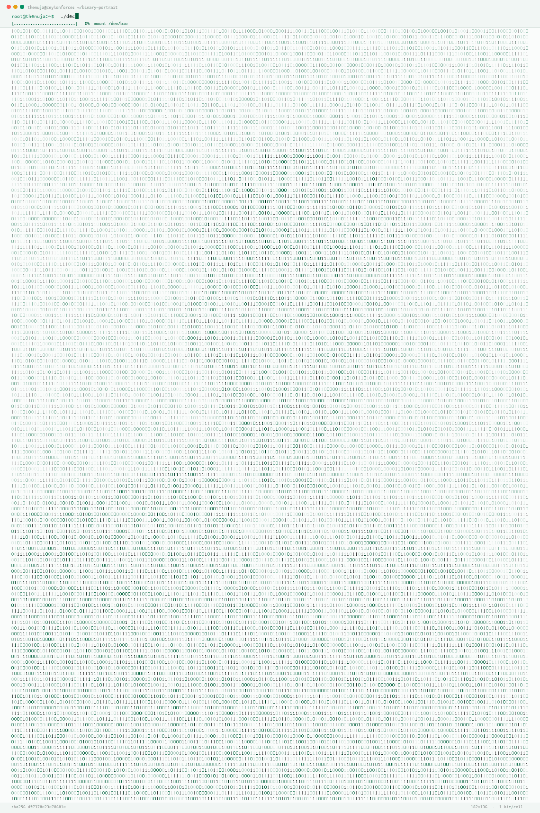

<div align="center">


<a href="https://github.com/Thenuja23">
  
</a>

<br/>

<a href="https://github.com/Thenuja23">
  
</a>


</div>

---


### Contribution Snake

<div align="center">
<picture>
  <source media="(prefers-color-scheme: dark)" srcset="https://raw.githubusercontent.com/Thenuja23/Thenuja23/output/github-snake-dark.svg" />
  <source media="(prefers-color-scheme: light)" srcset="https://raw.githubusercontent.com/Thenuja23/Thenuja23/output/github-snake.svg" />
  
</picture>
</div>

## About Me


**Hello, I'm Thenuja Vilothmin Ganganath. Founder & CEO of Ceylonforce Holdings (Pvt) Ltd** and a **2nd-year Computer Science student at the University of Westminster** 

I love turning ideas into working products, especially in **machine learning, algorithms and neural networks**.

#### My Educational Background:  <br>
Richmond College → International College of Business and Technology (ICBT) → Informatics Institute of Technology (IIT) → University of Westminster <br>
<p align="center">
  &nbsp;&nbsp;&nbsp;
  &nbsp;&nbsp;&nbsp;
  &nbsp;&nbsp;&nbsp;
  
</p>

## 🧬 This Bio, in Binary

<div align="center">
<picture>
  <source media="(prefers-color-scheme: dark)"  srcset="assets/binary/portrait_dark.gif" />
  <source media="(prefers-color-scheme: light)" srcset="assets/binary/portrait_light.gif" />
  
</picture>

<sub><code>root@thenuja:~$ ./decrypt --portrait</code></sub>

**12,720 bits · 1,590 bytes · 182 × 136 cells · one bit per glyph**
</div>

Every glyph above is one bit, used exactly once. Group the bits in 8s, read MSB-first, and the portrait spells this bio back out as ASCII:

```text
01000110 01101111 01110101 01101110 01100100 01100101 01110010
    F        o        u        n        d        e        r
```

<details>
<summary><b>Copy the full bit art</b> — 12,720 bits, 136 lines</summary>

Use the copy icon on the block below, then read every 8 bits as one ASCII byte.

```text
                                                                                                                                                                                      
                                                                                                                                                                                      
                                                                                                                                                                                      
                                                                                                                                                                                      
                                                                                                                                                                                      
                                                                                                                                                                                      
                                                                                                                                                                                      
                                                                                                                                                                                      
                                                                                                                                                                                      
                                                                                                                                                                                      
                                                                                                                                                                                      
                                                                                                                                                                                      
                                                                                                                                                                                      
                                                                                                                                                                                      
                                                                                                                                                                                      
                                                                                                                                                                                      
                                                                                                                                                                                      
                                                                                                                                                                                      
                                                                                                                                                                                      
                                                                                                                                                                                      
                                                                                                                                                                                      
                                                                                         0    10001100110111101                                                                       
                                                                            110101011011100110010001100101011100100010                                                                
                                                                         000000100110001000000100001101000101010011110010000                                                          
                                                                        00110111101100110001000000100001101100101011110010110110                                                      
                                                                       00110111101101110011001100110111101110010011000110110010100                                                    
                                                                     100000010010000110111101101100011001000110100101101110011001110                                                  
                                                                   111001100100000001010000101000001110110011101000010100100100000010                                                 
                                                                   01100011101000110010000100000011000010110111001100100001000000110000                                               
                                                                  1001000000011001001101110011001000010110101111001011001010110000101110                                              
                                                                 010001000000100001001010011011000110010000000101000010010000110111101101                                             
                                                                11001110011001010010010000001000011011011110110110101110000011101010111010                                            
                                                                 0011001010111001000100000010100110110001101101001011001010110111001100011                                            
                                                                 01100101001000000111001101110100011101010110010001100101011011100111010000                                           
                                                                 10000001100001011101000010000001110100011010000110010100100000010101010110                                           
                                                                111001101001011101100110010101110010011100110110100101110100011110010010000                                           
                                                                001101111011001100010000001010111011001010111001101110100011011010110100101                                           
                                                                101110011100110111010001100101011100100010110000100000011000100110000101110                                           
                                                                0110110010101100100001000000110100101101110001000000100011101100001011011000                                          
                                                                110110001100101001011000010000001010011011100100110100100100000010011000110                                           
                                                                000101101110011010110110000100101110000010100000101001001001001000000110001                                           
                                                                001110101011010010110110001100100001000000110000101100011011100100110111101                                           
                                                                 1100110111001100100000011101000110100001100101001000000111001101110100011                                            
                                                                  000010110001101101011001110100010000001110111011001010110001001110011011                                            
                                                                  01001011101000110010101110011001011000010000001110111011001010110001000                                             
                                                                  1000000110000101110000011100000111001100101100001000000110110101101111                                              
                                                                   01100010011010010110110001100101001000000110000101110000011100000111                                               
                                                               00110010110000100000011100110110111101100110011101000111011101100001011                                                
                                                              100100110010100101100001000000011001101000100001000000110110101101111011                                                
                                                             001000110010101101100011100110010000001100001011011100110010000100000011                                                 
                                                            011010110000101100011011010000110100101101110011001010010000001101100011                                                  
                                                            001010110000101110010011011100110100101101110011001110010000001110011011011                                               
                                                            1101101100011101010111010001101001011011110110111001110011001011000010000001                                              
                                                             1000010110111001100100001000000100100100100000011101000111010101110010011011                                             
                                                             1000100000011010010110010001100101011000010111001100100000011010010110111001                                             
                                                              11010001101111001000000111011101101111011100100110101101101001011011100110                                              
                                                              01110010000001110000011100100110111101100100011101010110001101110100011100                                              
                                                               110010111000100000010011010111100100100000011011010110000101101001011011                                               
                                                                1000100000011010010110111001110100011001010111001001100101011100110111                                                
                                                                  0100011100110010000001100001011100100110010100100000011011010110000                                                 
                                                                       1011000110110100001101001011011100110010100100000011011000110                                                  
                                                                       0101011000010111001001101110011010010110111001100111001011000                                                  
                                                                       01000000110000101101100011001110110111101110010011010010111                                                    
                                                                        010001101000011011010111001100101100001000000110010001                                                        
                                                                        10010101100101011100000010000001101100011001010110000                                                         
                                                                        1011100100110111001101001011011100110011100100000011                                                          
                                                                        000010110111001100100001000000110111001100101011101                                                           
                                                                        01011100100110000101101100001000000110111001100101                                                            
                                                                        011101000111011101101111011100100110101101110011                                                              
                                                                        0010111000001010000010100101011101001000010000                                                                
                                                                        010101010000100000010010010010000001000100010                                                                 
                                                                    011  1100001010001011010010000001000110011011110                                                                  
                                                                 11101    010110111001100100011001010111001000100000                                                                  
                                                               0010011     0001000000100001101000101010011110010110                                                                   
                                                             000100000       01000011011001010111100101101100011011                                                                   
                                                          1101101110011        0011001101111011100100110001101100101                                                                  
                                                       0010000001001000          011011110110110001100100011010010110                                                                 
                                                   111001100111011100110           0111010001000000110001001110101011                                                                 
                                             0100101101100011001000110100            10110111001100111001000000110000                                                                 
                                       10110111001100100001000000110110001             10000101110101011011100110001  1                                                               
                                 011010000110100101101110011001110010000001              101101011110010010000001101  11                                                              
                          10111011101101110001000000111010001100101011000110                1101000001000000111000    0011                                                            
                 100100110111101100100011101010110001101110100011100110000101                 000101101001000000      10000                                                           
           1001110101011100110110100101101110011001010111001101110011001000000 1                0001000110010        101110110                                                        
      011001010110110001101111011100000110110101100101011011100111010000100000                  0100010101           11100001100                                                      
  10101100011011101010111010001101001011101100110010100101100001000000100010101 1             101100110111          101101100011101                                                   
01011101000110010100100000010100000111011001110100001000000100110001110100011001 0          000100000001010        0000110010001100000                                                
011001000110110001000000111010001101111001000000111000001110010011001010111001101          100101011011100111      010000101001001110100010                                           
000001100011011011000110100101100101011011100111010000100000011011110111010101110         1000111001001100101     0110000101100011011010000010                                        
1100001000000111000001110010011001010111001101100101011011100111010001100001011101       000110100101101111011    01110011100110010000001100001011                                    
01110011001000010000001110010011001010110110001100001011101000110100101101111011011    10011100110110100001101     00101110000001000000110110101100001                                
011011100110000101100111011001010110110101100101011011100111010000001010001011010010  0000010001100111001001100   1010110010101101100011000010110111001100                            
011011001010010000001000111011100100110000101110000011010000110100101100011001000000 100 0 100011001010111001101   101001011001110110111001100101011100100010                         
11000010000001000100011001010111001101101001011001110110111000100000010000110111001001100001   011001100111010000  1000000101001101110100011101010110010001101001                     
01101111001000000010100000110010001100000011001000110010001000000111010001101111001000 0   0 0 11100000111001  001 1001010111001101100101011011100111010000101001001                  
11010001000000110110001101111011001110110111101110011001011000010000001100010011100100 1     1000010110111001    10010001101001011011100110011100100000011000010110111                
001100100001000000110110101100001011100100110101101100101011101000110100101101110011001       110010000001 1 1     011001101001011100110111010101100001011011000111001100             
1000000110011001101111011100100010000001100011011011000110100101100101011011100111010001     1100110000101000   0  01010010101000100010101000011010010000010000001010011010           
1010001000001010000110100101100001010001011010010000001001100011000010110111001100111011 1   01010110000101    10  0111011001010111001100111010001000000101000001111001011101         
00011010000110111101101110001011000010000001001010011000010111011001100001001011000010000 0 010010100110000    1   01110110011000010101001101100011011100100110100101110000011        
10100001011000010000001010100011110010111000001100101010100110110001101110010011010010111   000001110100001    0     1100001000000101000001001000010100000010110000100000010010       
000101010001001101010011000010111101000011010100110101001100001010001011010010000001000100  0110000101110100  0     11000010110001001100001011100110110010101110011001110100010       
000001001101011110010101001101010001010011000010110000100000010011010110000101110010011010  01011000010100010 0     010000100000101000101101001000000100110101001100001000000010      
0110001000000100010001100001011101000110000100111010001000000100111001110101011011010101000 001111001001011000      010000001010000011000010110111001100100011000010111001100101      
100001000000111001101100011011010010110101101101001011101000010110101101100011001010110000101110010011011100010     110000100000010101000110010101101110011100110110111101110010      
010001100110110001101111011101110010110000100000010010100111010101110000011110010111010001100101011100100000101     0001011010010000001010100011011110110111101101100011100110011     
1010001000000100011101101001011101000010110000100000010001110110100101110100010010000111010101100010001011000010    0000010101100101001100100000010000110110111101100100011001010     
0101100001000000100100101101110011101000110010101101100011011000110100101001010001000000100100101000100010001010   10000010010110000100000010100000111100101000011011010000110000     
1011100100110110100101100001000000100110001101001011011100111010101111000000010100000101001000101010001000101010   101000011010000010101010001001001010011110100111000001010001011    
01001000000101010101101110011010010111011001100101011100100111001101101001011101000111100100100000011011110110011  000100000010101110110010101110011011101000110110101101001011011    
10011100110111010001100101011100100011101000100000010000100101001101100011001000000010100001001000011011110110111 0011100110010100100100000010000110110111101101101011100000111010    
10111010001100101011100100010000001010011011000110110100101100101011011100110001101100101001011000010000000110010 00110000001100100011010100100000011101000110111100100000001100100   
01100000011001000111001000010100010110100100000010010010110111001100110011011110111001001101101011000010111010001 10100101100011011100110010000001001001011011100111001101110100011   
01001011101000111010101110100011001010010000001101111011001100010000001010100011001010110001101101000011011100110111101101100011011110110011101111001001000000010100001001001010010   
010101010000101001001110100010000001000110011011110111010101101110011001000110000101110100011010010110111101101110001000000100001101100101011100100111010001101001011001100110100101  
100011011000010111010001100101001000000110100101101110001000000100100001101001011001110110100001100101011100100010000001000101011001000111010101100011011000010111010001101001011011  
110110111000100000001010000100100101010100001010010010110000100000010011010110010101110010011010010111010000001010001011010010000001001001010000110100001001010100001000000100001101  
1000010110110101110000011101010111001100111010001000000100100101101110011101000110010101110010011011100110000101110100011010010110111101101110011000010110110000100000010001000110100 
1011100000110110001101111011011010110000100100000011010010110111000100000010100110111000001101111011010110110010101101110001000000100010101101110011001110110110001101001011100110110 
1000000010100010110100100000010100100110100101100011011010000110110101101111011011100110010000100000010000110110111101101100011011000110010101100111011001010011101000100000010001110 
0101110010000110010111001000101001011100010000001000001011001000111011001100001011011100110001101100101011001000010000001001100011001010111011001100101011011000010000000101000010010 
01010000110101010000101100001000000101001101100011011010010110010101101110011000110110010100100000011001100110111101110010001000000101010001100101011000110110100001101110011011110110
11000110111101100111011110010010100100100000011000010110111001100100001000000100111101110010011001000110100101101110011000010111001001111001001000000100110001100101011101100110010101
10110000001010000010100101001101010100010100100100010101001110010001110101010001001000010100110011101000100000011000110110110001101001011001010110111001110100001000000110110101100001
01101110011000010110011101100101011011010110010101101110011101000010110000100000011011000110010101100001011001000110010101110010011100110110100001101001011100000010110000100000011000
11011100100110100101110100011010010110001101100001011011000010000001110100011010000110100101101110011010110110100101101110011001110010110000100000011101000110010101100001011011010111
01110110111101110010011010110010110000100000011000110110111101101101011011010111010101101110011010010110001101100001011101000110100101101111011011100010110000100000011100010111010101
10100101100011011010110010000001101100011001010110000101110010011011100110100101101110011001110000101001001100010000010100111001000111010101010100000101000111010001010101001100111010
00100000010001010110111001100111011011000110100101110011011010000010110000100000010100110110100101101110011010000110000101101100011000010000101000001010010000110101010101010010010100
10010001010100111001010100010011000101100100111010001000000100110001101111011011110110101101101001011011100110011100100000011001100110111101110010001000000110100101101110011101000110
01010111001001101110011100110110100001101001011100000111001100100000011010010110111000100000011011010110000101100011011010000110100101101110011001010010000001101100011001010110000101
11001001101110011010010110111001100111001000000110000101101110011001000010000001110011011011110110011001110100011101110110000101110010011001010010000001100100011001010111011001100101
01101100011011110111000001101101011001010110111001110100001011000010000001100001011011100110010000100000011011110111000001100101011011100010000001110100011011110010000001100011011011
11011011100111010001110010011010010110001001110101011101000110100101101110011001110010000001110100011011110010000001101111011100000110010101101110001000000111001101101111011101010111
00100110001101100101001011100000101000001010010011000110010101110100001001110111001100100000011000110110111101101110011011100110010101100011011101000010000001100001011011100110010000
10000001100010011101010110100101101100011001000010000001110011011011110110110101100101011101000110100001101001011011100110011100100000011001110111001001100101011000010111010000100001
```

</details>

Verify it — the art is a bit-exact copy of the payload, fingerprint `d97378e23e78681e`:

```bash
cd assets/binary
python3 portrait_binary.py --verify-art portrait_binary.txt
python3 portrait_binary.py --decode portrait_binary.txt
```

##  Tech Stack

<div align="center">

**Languages**


**Frameworks & Libraries**


**CMS**


**Databases**


**Cloud & Deployment**


**Machine Learning & Data**


**AI Tools**


**Design & 3D**


**Package Managers**


**Tools**


</div>

---


## 📊 GitHub Stats

<div align="center">

<picture>
  <source media="(prefers-color-scheme: dark)" srcset="https://github-readme-stats.vercel.app/api?username=Thenuja23&show_icons=true&hide_border=true&count_private=true&bg_color=0d1117&title_color=10B981&icon_color=10B981&text_color=c9d1d9">
  <source media="(prefers-color-scheme: light)" srcset="https://github-readme-stats.vercel.app/api?username=Thenuja23&show_icons=true&hide_border=true&count_private=true&bg_color=ffffff&title_color=059669&icon_color=059669&text_color=24292f">
  
</picture>
<picture>
  <source media="(prefers-color-scheme: dark)" srcset="https://github-readme-stats.vercel.app/api/top-langs/?username=Thenuja23&layout=compact&hide_border=true&bg_color=0d1117&title_color=10B981&text_color=c9d1d9">
  <source media="(prefers-color-scheme: light)" srcset="https://github-readme-stats.vercel.app/api/top-langs/?username=Thenuja23&layout=compact&hide_border=true&bg_color=ffffff&title_color=059669&text_color=24292f">
  
</picture>

<picture>
  <source media="(prefers-color-scheme: dark)" srcset="https://streak-stats.demolab.com?user=Thenuja23&hide_border=true&background=0d1117&ring=10B981&fire=10B981&currStreakLabel=10B981&sideLabels=c9d1d9&currStreakNum=c9d1d9&sideNums=c9d1d9&dates=8b949e">
  <source media="(prefers-color-scheme: light)" srcset="https://streak-stats.demolab.com?user=Thenuja23&hide_border=true&background=ffffff&ring=059669&fire=059669&currStreakLabel=059669&sideLabels=24292f&currStreakNum=24292f&sideNums=24292f&dates=57606a">
  
</picture>

</div>

### 🏆 Trophies

<div align="center">
<picture>
  <source media="(prefers-color-scheme: dark)" srcset="https://github-profile-trophy.vercel.app/?username=Thenuja23&theme=onedark&no-frame=true&no-bg=true&row=1&column=7&margin-w=10">
  <source media="(prefers-color-scheme: light)" srcset="https://github-profile-trophy.vercel.app/?username=Thenuja23&theme=flat&no-frame=true&no-bg=true&row=1&column=7&margin-w=10">
  
</picture>
</div>

---

## 📈 Contribution Activity

<div align="center">
<picture>
  <source media="(prefers-color-scheme: dark)" srcset="https://github-readme-activity-graph.vercel.app/graph?username=Thenuja23&bg_color=0d1117&color=10B981&line=10B981&point=ffffff&area=true&area_color=10B981&hide_border=true">
  <source media="(prefers-color-scheme: light)" srcset="https://github-readme-activity-graph.vercel.app/graph?username=Thenuja23&bg_color=ffffff&color=059669&line=059669&point=24292f&area=true&area_color=059669&hide_border=true">
  
</picture>
</div>


### 🧮 Detailed Metrics

<div align="center">
  
</div>

---


## 🎯 Currently Focused On

- [x] Core Computer Science fundamentals
- [x] Python & Java development
- [ ] Deep Learning & neural networks
- [ ] Building and launching my own tech products
- [ ] Contributing to open source

---

### Founder & CEO of the Ceylonforce Holdings (Pvt) Ltd


## 🤝 Let's Connect

<div align="center">

<a href="https://github.com/Thenuja23"></a>
<a href="https://www.linkedin.com/in/thenuja-vilothmin-39201a316"></a>
<a href="mailto:thenujaganganath23@gmail.com"></a>
<a href="https://instagram.com/thenuja_vilothmin"></a>

<br/><br/>

<picture>
  <source media="(prefers-color-scheme: dark)" srcset="https://quotes-github-readme.vercel.app/api?type=horizontal&theme=dark">
  <source media="(prefers-color-scheme: light)" srcset="https://quotes-github-readme.vercel.app/api?type=horizontal&theme=light">
  
</picture>

<br/>


</div>
